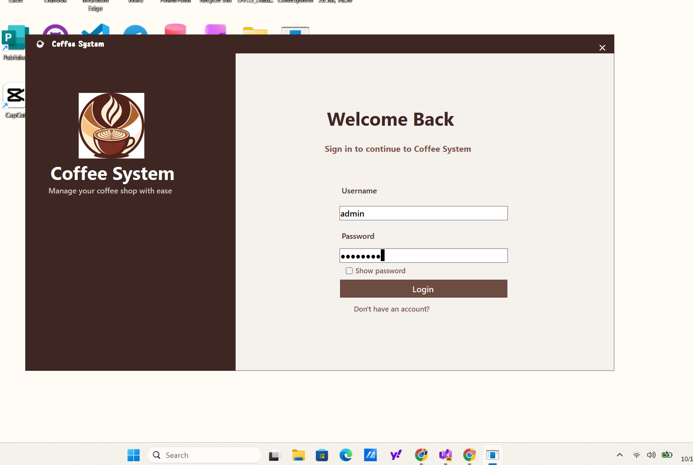
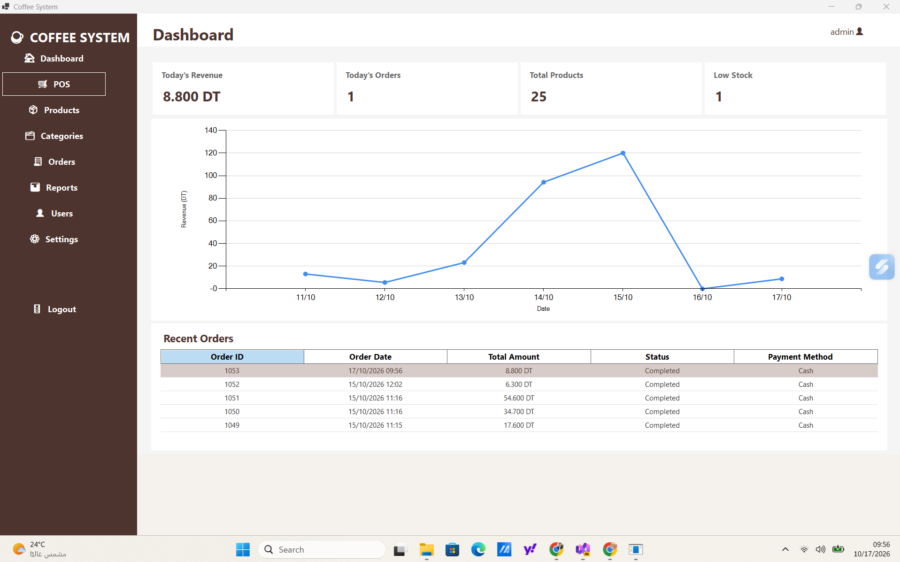
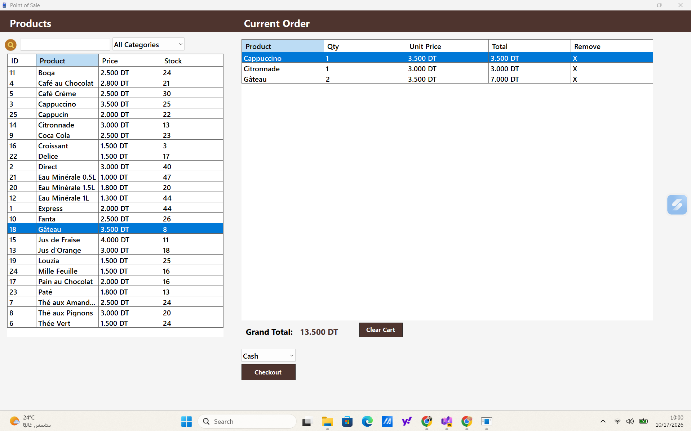

# ☕ Coffee Shop Management System

### 🚀 A Smart Desktop Solution for Modern Coffee Shops

A feature-rich coffee shop management application built with **C# · .NET 8 · Windows Forms · Entity Framework Core · SQL Server**.

🎯 Designed to simplify daily café operations through sales management, inventory tracking, user administration, reporting, and receipt printing.

---

## 📸 About the Project

Coffee Shop Management System is a desktop application developed to manage the essential operations of a coffee shop from one centralized interface.

The project focuses on **clean architecture, reliable data handling, asynchronous database operations, and a user-friendly experience**.

## ✨ Key Features

### 📊 Dashboard
- 💰 Revenue and sales statistics
- 🧾 Recent orders overview
- 📉 Low-stock alerts
- 📈 Daily revenue chart

### 🛒 Point of Sale (POS)
- 🔎 Search products by name
- 🗂️ Filter products by category
- 🛍️ Shopping cart management
- 💳 Cash and card payment methods
- 📦 Stock validation during checkout
- 🔄 Transaction-based order creation

### ☕ Product Management
- ➕ Add new products
- ✏️ Update product information
- 🖼️ Upload and manage product images
- 🔍 Search and filter products
- ♻️ Soft delete and restore products

### 🗂️ Category Management
- ➕ Create and edit categories
- 🔎 Search categories
- 🗑️ Deactivate categories without permanently deleting their records
- ♻️ Restore inactive categories

### 👥 User Management
- 🔐 Authentication and password hashing with BCrypt
- 🛡️ Admin and Cashier roles
- ✅ User account activation and deactivation
- 🔎 Username validation and database uniqueness constraint

### 🧾 Order Management
- 📋 View sales history
- 📅 Filter orders by date
- 💵 Filter by payment method
- 🔍 Search orders by ID
- 📄 View order details

### 📈 Reports & Analytics
- 💰 Sales summaries and revenue analysis
- 📊 Daily revenue trends
- 🏆 Best-selling products
- 💳 Payment-method analysis
- 📤 Export reports to CSV

### 🖨️ Receipt Printing
- 🧾 Printable receipt preview
- ☕ Custom café name and address
- 📞 Café contact information
- 💬 Custom receipt footer
- 👤 Cashier and order information

### ⚙️ Settings
- 🏪 Configure café information
- 📝 Customize receipt footer
- 📦 Configure the low-stock threshold

---

## 🧱 Architecture

The solution is organized into three main layers to separate responsibilities and improve maintainability.

```text
☕ Coffee Shop Management System
│
├── 🖥️ CoffeSystem_1UI
│   └── Windows Forms — User Interface
│
├── 🧠 CoffeSystem_Business
│   └── Services — Business Logic
│
└── 🗄️ CoffeSystem_DataAccess
    ├── Entities
    ├── Repositories
    ├── AppDbContext
    ├── DTOs
    └── EF Core Migrations
             │
             ▼
       🗃️ SQL Server
```

### 🔄 Application Flow

`User Interface → Business Services → Repositories → Entity Framework Core → SQL Server`

---

## 🛠️ Tech Stack

| Technology | Purpose |
|---|---|
| 💻 C# | Application development |
| ⚙️ .NET 8 | Application framework |
| 🪟 Windows Forms | Desktop user interface |
| 🗄️ Microsoft SQL Server | Relational database |
| 🔗 Entity Framework Core 8 | ORM and database access |
| 🧩 LINQ | Data querying and filtering |
| ⚡ Async / Await | Non-blocking database operations |
| 🔒 BCrypt | Password hashing |
| 🧬 Git & GitHub | Version control |

---

## 🛡️ Engineering Highlights

- 🏗️ **Layered Architecture** — separation of UI, business logic, and data access.
- ⚡ **Asynchronous Data Access** — EF Core async queries and save operations.
- 🔄 **Transactional Checkout** — order creation and stock updates handled in a database transaction.
- ↩️ **Rollback Handling** — failed checkout operations can roll back database changes.
- 🔐 **Password Security** — BCrypt password hashing.
- ✅ **Data Integrity** — unique username constraint and validation rules.
- ♻️ **Soft Delete** — products and categories can be restored.
- 🧾 **DTO-Based Reporting** — structured report data for summaries and analytics.

---

## 🚀 Getting Started

### 📋 Prerequisites

Make sure you have:

- 💻 Visual Studio with .NET desktop development support
- ⚙️ .NET 8 SDK
- 🗃️ Microsoft SQL Server
- 🔧 Entity Framework Core tooling

### ⚡ Installation

1. 📥 Clone or download this repository.
2. 📂 Open the solution file (`.sln`) in Visual Studio.
3. 📦 Restore the required NuGet packages.
4. ⚙️ Create a local `appsettings.json` using `appsettings.example.json` as a template, and configure your SQL Server connection string.
5. 🗄️ Apply the existing Entity Framework Core migrations to your database.
6. 🏗️ Build the solution.
7. ▶️ Run the Windows Forms startup project.

🔒 **Security note:** Keep local connection strings, credentials, and real database files out of version control.

---

## 🖼️ Screenshots

📸 Screenshots of the dashboard, POS, product management, reports, and receipt preview can be added here to showcase the application's interface.





---

## 🎯 Project Goals

This project was developed to strengthen practical skills in:

- 💻 C# and .NET application development
- 🧱 Layered software architecture
- 🗄️ Relational database design
- ⚡ Asynchronous programming
- 🔐 Authentication and access control
- 📊 Reporting and data analysis
- 🛒 Real-world business workflows

---

## 👨‍💻 Author

**Anis Chaabouni**

🎓 Junior .NET / Full-Stack Developer  
📍 Tunisia

---

⭐ *Built with ☕, C#, and a passion for software development.*

